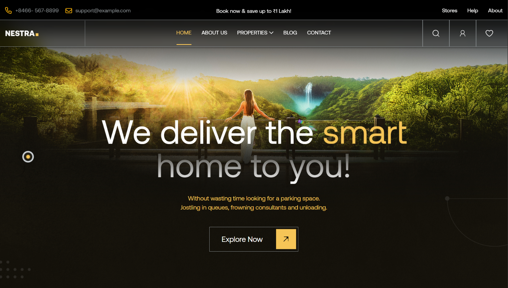
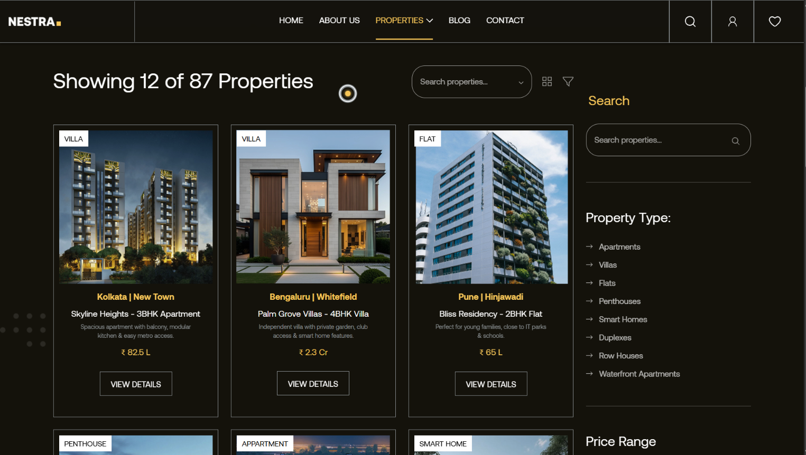

# 🏡 NESTRA — LUXURY REAL ESTATE

<div align="center">

  

  <br/>

**WHERE ELEGANCE MEETS MODERN LIVING.**

A modern, visually immersive real estate website designed to showcase premium residential properties and deliver an engaging property-browsing experience.

  <br/>


<br/><br/>

<a href="#-screenshots">SCREENSHOTS</a> •
<a href="#-features">FEATURES</a> •
<a href="#-tech-stack">TECH STACK</a> •
<a href="#-installation">INSTALLATION</a> •
<a href="#-live-demo">LIVE DEMO</a>

<br/><br/>

  <a href="https://developerr0nit.github.io/NESTRA/">
    
  </a>

</div>

---

## ◈ ABOUT THE PROJECT

**NESTRA** is a premium real estate website built to make property exploration visually appealing, intuitive, and seamless.

Featuring an elegant interface, interactive elements, smooth animations, and responsive layouts, NESTRA brings a modern property-browsing experience to desktops, tablets, and mobile devices.

---

## ◈ SCREENSHOTS

<div align="center">

  <h3>01 — HOME PAGE</h3>
  

<br/><br/>

  <h3>02 — ABOUT US</h3>
  

<br/><br/>

  <h3>03 — PROPERTY COLLECTION</h3>
  

<br/><br/>

  <h3>04 — PROPERTY DETAILS</h3>
  

</div>

---

## ◈ FEATURES

**Designed to deliver a premium and interactive browsing experience.**

| Feature                    | Description                                                                |
| :------------------------- | :------------------------------------------------------------------------- |
| ✨ **Modern UI**           | Clean, elegant, and visually appealing real estate interface.              |
| 📱 **Responsive Design**   | Optimized layouts for desktops, tablets, and mobile devices.               |
| 📄 **Multiple Pages**      | Dedicated Home, About Us, Properties, and Property Details pages.          |
| 🏡 **Property Showcase**   | Displays property categories, featured listings, and property information. |
| 🎠 **Interactive Sliders** | Smooth, touch-friendly carousels for browsing property collections.        |
| 🎬 **Scroll Animations**   | Animated elements that appear as users navigate through the website.       |
| 🖱️ **Custom Cursor**       | Enhanced browsing experience with custom cursor effects.                   |
| ⏳ **Loading Animation**   | Custom preloader for a polished loading experience.                        |
| 🧭 **Navigation**          | Responsive navigation menu with dropdowns and search interface.            |

---

## ◈ TECH STACK

**Powered by modern frontend technologies and interactive libraries.**

|     Technology     | Purpose                           |
| :----------------: | :-------------------------------- |
|    🌐 **HTML5**    | Website structure and content     |
|    🎨 **CSS3**     | Styling and responsive layouts    |
| ⚡ **JavaScript**  | Interactive functionality         |
| 🅱️ **Bootstrap 5** | Responsive grid and UI components |
|  🎠 **Swiper.js**  | Interactive sliders and carousels |
|     ✨ **AOS**     | Scroll-based animations           |
|   🌊 **Luxy.js**   | Smooth scrolling effects          |

---

## ◈ PROJECT STRUCTURE

```text
NESTRA/
│
├── assets/
│   ├── common/
│   ├── home/
│   ├── about-us/
│   ├── properties/
│   ├── screenshots/
│   └── fonts/
│
├── css/
│   ├── common.css
│   ├── index.css
│   ├── about-us.css
│   ├── properties.css
│   └── property-details.css
│
├── js/
│   ├── common.js
│   ├── home.js
│   └── luxy.js
│
├── index.html
├── about-us.html
├── properties.html
└── property-details.html
```

---

## ◈ INSTALLATION

**Set up NESTRA locally and explore the project.**

### 01 — Clone the repository

```bash
git clone https://github.com/DeveloperR0nit/NESTRA.git
```

### 02 — Navigate to the project directory

```bash
cd NESTRA
```

### 03 — Launch the website

Open `index.html` in your browser.

Alternatively, use the **Live Server** extension in VS Code for a better development experience.

---

## ◈ LIVE DEMO

<div align="center">

  <a href="https://developerr0nit.github.io/NESTRA/">
    
  </a>

<br/><br/>

**Experience the website in action.**

[🌐 Open NESTRA Website](https://developerr0nit.github.io/NESTRA/)

</div>

---

## ◈ DEVELOPER

<div align="center">

**RONIT SAHA**

Frontend Developer | Creative Web Enthusiast

  <a href="https://github.com/DeveloperR0nit">
    
  </a>

</div>

---

<div align="center">

## 🏡 FIND YOUR PLACE. FIND YOUR NESTRA.

**ELEGANCE. COMFORT. MODERN LIVING.**

  <br/>

Built with ❤️ and creativity.

  <br/>


<br/><br/>

⭐ **If you like this project, consider giving the repository a star!**

</div>
