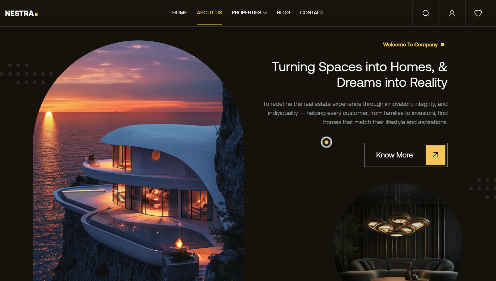
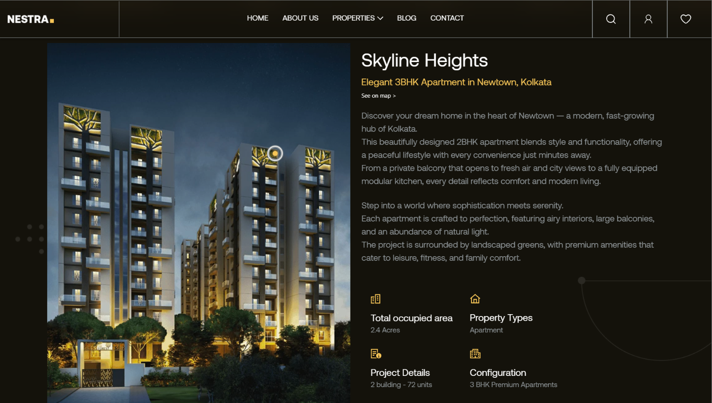

# 🏡 NESTRA – Real Estate Website

**NESTRA** is a modern, visually appealing real estate website designed to showcase premium residential properties and provide users with an engaging property-browsing experience.

The website features an elegant interface, interactive elements, smooth animations and responsive layouts to make property exploration seamless across different devices.

## ✨ Features

- **Modern UI:** Clean, elegant and visually appealing real estate interface.
- **Responsive Design:** Optimized layouts for desktops, tablets and mobile devices.
- **Multiple Pages:** Dedicated Home, About Us, Properties and Property Details pages.
- **Property Showcase:** Displays different property categories, featured listings and property information.
- **Interactive Sliders:** Smooth, touch-friendly carousels for browsing property collections.
- **Scroll Animations:** Animated elements that appear as users navigate through the website.
- **Custom Cursor:** Enhanced browsing experience with custom cursor effects.
- **Loading Animation:** Custom preloader for a polished loading experience.
- **Navigation:** Responsive navigation menu with dropdowns and search interface.

## 🛠️ Tech Stack

| Technology | Purpose |
|---|---|
| HTML5 | Website structure |
| CSS3 | Styling and responsive layouts |
| JavaScript | Interactive functionality |
| Bootstrap 5 | Responsive grid and UI components |
| Swiper.js | Interactive sliders and carousels |
| AOS | Scroll-based animations |
| Luxy.js | Smooth scrolling effects |

## 📸 Screenshots

Add screenshots of your actual website here to showcase its design and functionality.

### Home Page


### About Us Page



### Properties Page


### Property Details Page



## 📂 Project Structure

```text
NESTRA/
│
├── assets/
│   ├── common/
│   ├── home/
│   ├── about-us/
│   ├── properties/
│   └── fonts/
│
├── css/
│   ├── common.css
│   ├── index.css
│   ├── about-us.css
│   ├── properties.css
│   └── property-details.css
│
├── js/
│   ├── common.js
│   ├── home.js
│   └── luxy.js
│
├── index.html
├── about-us.html
├── properties.html
└── property-details.html
```

## 🚀 Getting Started

Follow these steps to run the project locally.

**1. Clone the repository**

```bash
git clone https://github.com/DeveloperR0nit/NESTRA.git
```

**2. Navigate to the project directory**

```bash
cd NESTRA
```

**3. Run the project**

Open `index.html` in your browser.

Alternatively, use the Live Server extension in VS Code for a better development experience.

## 🌐 Live Demo

[View NESTRA Live](https://developerr0nit.github.io/NESTRA/)

## 👨‍💻 Author

**Ronit Saha**

- GitHub: [@DeveloperR0nit](https://github.com/DeveloperR0nit)

---

⭐ If you like this project, consider giving the repository a star!